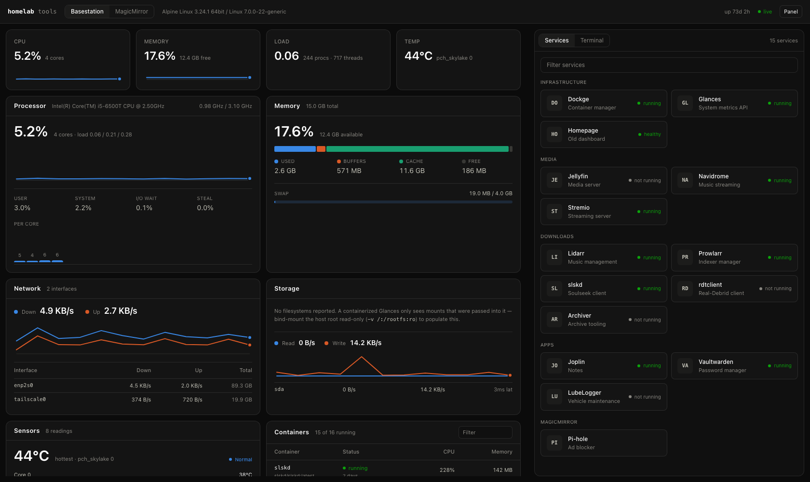

# helm

One app for running a homelab: live metrics from [Glances](https://nicolargo.github.io/glances/)
across any number of nodes, a launcher for your services, and a terminal.

It replaces a Homepage instance and a `ssh` window with one thing you can pin to
a phone home screen, where it behaves like a native iOS app.



## What it does

- **Metrics** — CPU (total, per core, and the user/system/iowait split), memory
  composition, swap, load, network throughput, disk I/O, filesystems, sensors,
  containers and processes. Sparklines keep 60 samples of history per node.
- **Alerts** — pushed to your phone through [ntfy](https://ntfy.sh) when
  something actually breaks, so you find out without opening anything.
- **Container control** — restart, stop, start and tail logs from the phone,
  for the node this server runs on. Destructive actions confirm first, with
  the native iOS action sheet.
- **Apps** — a home-screen style launcher for everything you run, with each
  app's real icon. An app that names its container shows only while that
  container is running; stopped ones are counted and left to the Containers
  page, which is where you'd start them. Pick a few favorites (in setup, or
  Settings → Apps) and they sit at the top of the home page. Icons come from
  [dashboard-icons](https://github.com/homarr-labs/dashboard-icons) and are
  fetched once by the server and cached on disk, so the browser never talks to a
  CDN.
- **Terminal** — a real PTY over a WebSocket, with full job control (`Ctrl+C`,
  `Ctrl+Z`, `fg`/`bg`) and a configurable command palette. Runs as *you*, not
  root — so rootless `podman` works against your own socket, and `sudo` covers
  the rest. On touch devices it grows a key bar for the things a phone keyboard
  has no key for: Ctrl, Esc, Tab, arrows, `^C`/`^Z`/`^D`.
- **Multi-node** — every node in `config.json` gets a card on the home page,
  which leads with anything that needs attention (a crash-looping container, a
  disk past the alert threshold, a sensor at its limit). Nothing is hard-coded;
  point it at one machine or twelve.
- **Mobile first** — an [Ionic](https://ionicframework.com) app drawn in iOS
  style on every platform: four tabs (Machines, Apps, Containers, Terminal)
  behind a bottom tab bar on every screen size, native navigation bars with
  collapsing large titles, pull to refresh, sheets you drag down to close, in
  light or dark following the device setting. Built to live on an iPhone home
  screen.

## Quick start

```sh
bun install
bun dev                              # API on :3001, UI on :5173
```

With no config anywhere, the server starts in setup mode: it prints a setup
code in its log (and writes it to `./setup-code`), and opening the UI walks you
through [first-run setup](#first-run-setup), which writes `./config.json`. To
skip that, `cp config.example.json config.json` and edit it by hand first. A
config at `~/.config/helm/config.json` or `/etc/helm/config.json` on the
development machine counts too, and is the one that gets loaded and saved to.

`bun dev` runs the Bun server and Vite together; Vite proxies `/api` (including
the stack-output WebSocket) and `/pty` to the server, so the browser sees one
origin and development and production behave identically. `bun run dev:web`
runs Vite alone; point it at a server somewhere else with
`HELM_SERVER=http://server:3001 bun run dev:web`.

For a production run on this machine:

```sh
bun run build      # vue-tsc, then vite build → dist/
bun start          # serves the built UI, the API and the PTY on :3001
```

`bun run lint` runs ESLint. There is no test suite.

**`dist/` is committed and is what servers run**, so a frontend change is not
done until `bun run build` has been run and the regenerated `dist/` committed
with it.

## Installing on a server

`dist/` is committed, so the repo *is* the build. Clone it on the box and run
the installer once:

```sh
git clone <this repo> ~/helm
cd ~/helm
sudo ./install.sh
```

On a fresh install it ends by printing the URL and a one-time setup code:

```
Open http://<host>:3001/ and enter setup code ABCD-EFGH
```

Open that URL, enter the code, and answer a few questions — see
[First-run setup](#first-run-setup). There is no JSON to edit.

Nothing is compiled and nothing is copied — the systemd unit runs the server
straight out of the checkout. Updating is therefore just:

```sh
git -C ~/helm pull && sudo systemctl restart helm
```

An install from before first-run setup existed should re-run
`sudo ./install.sh` once after pulling. That makes `/etc/helm` owned by the
service user (mode 700), so Settings can save the config atomically — a temp
file beside it, then a rename. Until then saves still work, by rewriting
`config.json` in place, and the log says to re-run the installer.

```sh
sudo ./install.sh --port 3001
sudo ./install.sh --host 100.x.y.z   # pin an address instead of resolving one
sudo ./install.sh --no-tailscale     # no Tailscale: bind 127.0.0.1 (or pass --host)
sudo ./install.sh --uninstall        # removes the unit, keeps config + checkout
```

### Tailnet only

The terminal is a real shell on the box, so the service binds to this machine's Tailscale
address and nothing else. Not the LAN, not `0.0.0.0`. From any device on your
tailnet `http://<host>:3001` just works; from anywhere else the port is not
listening at all.

The address is resolved on every start by `bin/tailnet-env.sh`, which systemd
runs as `ExecStartPre`, rather than being frozen in at install time — so a boot
that gets ahead of `tailscaled` waits for it, and a changed tailnet IP is picked
up without reinstalling. If Tailscale never comes up the unit fails; it does not
fall back to a wider bind.

An access token is a second layer on top of the tailnet. First-run setup
offers to generate one (recommended, and the last question it asks); it is
shown once, saved in the browser that ran setup, and written to `auth.token`.
To set one by hand instead, put a string in `auth.token` in the config below
and restart. Either way the server then requires it as `?token=…`, an
`X-Helm-Token` header or `Authorization: Bearer …`. Open
`http://<host>:3001/?token=…` once and the app remembers the token and drops it
from the address bar; or enter it in **Settings** (the gear in every page's
navigation bar), which can test it against the server before saving.
`/api/health` is the one route that never needs it.

### Other websites can't drive it

The tailnet keeps strangers out, but not the web pages *you* visit: browsers
apply no CORS to WebSockets or to simple form-style POSTs, so without a check
any site open in a browser on your tailnet could open `/pty` — a real shell —
or stop a container, whenever no token is set. So every WebSocket upgrade
(`/pty`, `/api/stacks/stream`) and every `POST`/`PUT`/`DELETE`/`PATCH` is
origin-checked, and is allowed only if it:

- carries no `Origin` at all (not a browser — curl, scripts; the token still
  applies),
- has `Sec-Fetch-Site: same-origin`, which pages cannot forge,
- names this server's own host in `Origin` (matched against `Host`, or the
  `X-Forwarded-Host` the Vite dev proxy stamps), or
- comes from an origin listed in `server.allowedOrigins`.

Everything else gets a 403. The app is served by the server itself, so it is
same origin and `allowedOrigins` is empty by default; it is only for putting a
different frontend in front of helm:

```jsonc
"server": { "host": "…", "port": 3001,
            "allowedOrigins": ["https://dash.example.ts.net"] }
```

Entries must be exact origins (scheme, host, optional port); `*`, `null` and
paths are rejected at startup. Only those origins are sent
`Access-Control-Allow-Origin` (never `*`, never echoed back), and only they get
an answer to a CORS preflight. An allowlisted origin is let *through*; it is
not authenticated — that is still the token's job.

### Config and logs

Runtime config lives at `/etc/helm/config.json` (mode 600). The installer never
writes it: on a fresh install there is none, and first-run setup creates it;
a re-install leaves an existing one alone. `/etc/helm` itself belongs to the
service user, mode 700, since the service writes the config there (and keeps
its setup code there until setup is done). It is deliberately outside the repo,
since `config.json` is gitignored and may hold an access token and Glances
credentials.

```sh
journalctl -u helm -f
```

### Add to an iPhone home screen

This is the main way helm is meant to be used. Open the URL in Safari over your
tailnet → Share → **Add to Home Screen**. It launches standalone with no
browser chrome, and Ionic's navigation bar, tab bar and sheets pad for the
notch and the home indicator.

It is still Safari loading the same origin — there is no native wrapper — so
nothing needs configuring on the server. Two things to know:

- **The token.** A home-screen launch always opens `/`, with no `?token=` to
  pick up, and the installed app keeps its own storage, separate from Safari's.
  If the server sets `auth.token`, enter it once on **Settings** inside the
  installed app; it is kept in `localStorage` and survives relaunches.
- **The status bar** is opaque black (`apple-mobile-web-app-status-bar-style:
  black`), not translucent: a translucent bar lays the page out underneath it,
  and anything that missed the inset ended up under the notch. See the comment
  in `index.html`.

## First-run setup

A helm with no config file at any of the [search paths](#configuration), and
no `HELM_NODES`, starts unconfigured. Every page in the browser then goes to
`/setup`, a full-screen wizard:

1. **The setup code.** Printed by `install.sh`, logged on every start
   (`journalctl -u helm | grep 'setup code'`), and kept in
   `/etc/helm/setup-code` (mode 600) — next to wherever the config will be
   written — so it stays the same across restarts. It is eight characters, shown
   as `XXXX-XXXX`, with no `0`/`O` or `1`/`I`/`L` to misread off a terminal;
   case, spaces and the dash don't matter when typing it.
2. **Just this server, or this server and others.**
3. **This server** — its name and ID, and its Glances, which helm looks for
   at `http://127.0.0.1:61208` on its own. If nothing answers there, it shows
   copy-paste ways to install Glances so it survives a reboot (podman or Docker
   container, or `pipx` plus a user service), then Retry. For a single-server
   setup those bind Glances to `127.0.0.1`, since helm is the only thing that
   needs it.
4. **Apps on this server** — suggested from the machine's own containers
   (`podman`/`docker ps -a`): any container publishing a port becomes a toggle
   with its address filled in, using the host name you opened helm at.
5. **Other servers** (only if you chose that) — name, ID, Glances URL and
   optional Glances username/password, with a **Test** that the helm server runs
   (it is the one that will poll them, and your phone may not be able to reach
   them). A server that answers offers its containers as quick picks for its
   apps; the URLs are yours to fill in.
6. **Favorites** — which apps to pin to the top of Machines.
7. **Terminal commands** — presets as toggles (container ones for the engine
   found, plus `df -h`, `free -h`, `journalctl -f` and so on), and your own.
8. **Compose stacks** (optional, and only when helm found podman or docker on
   this server) — the folder stacks live in, the compose command, and the
   `compose.yaml` / `.env` a new stack starts from. Existing folders among
   `/opt/stacks` (Dockge's default), `~/stacks`, `~/docker` and `/srv/stacks`
   are offered with how many stacks each holds; the first that already has some
   is picked (else the first found), and with none found stacks start off. See
   [Stacks](#stacks) for what the folder may be. Skipping turns stacks off.
9. **Access token** — generate one, or none. A generated token is shown once,
   with a copy button, and saved on the device that ran setup; other devices
   enter it under Settings. If `HELM_TOKEN` is already set on the server, setup
   needs that token as well as the code (open the URL with `?token=…`), and
   can't generate another.
10. **Review**, then **Finish setup**.

The server validates the answers exactly as a startup would, writes the config
(atomically, mode 600) to `$HELM_CONFIG` — `/etc/helm/config.json` for the
installed service, `./config.json` in development — and loads it in-process.
There is no restart. The setup code file is deleted, and the setup endpoints
answer 409 from then on. Progress through the wizard is kept in the tab's
`sessionStorage`, so a reload (or iOS dropping the tab) picks up where it was.

**Until setup is finished, nothing else works.** Every API route except
`/api/health`, `/api/config` (only the defaults at that point) and
`/api/setup/*` answers 409, and so do both WebSockets — including the terminal,
which could otherwise simply `cat` the setup code and make it pointless. The
setup calls carry the code in an `X-Helm-Setup-Code` header, go through the same
origin check as every other mutation, and are rate-limited: after 10 wrong
codes in 10 minutes (counted across everyone, reset by a restart) every attempt
gets a 429 until the window passes. The code file sits in the config
directory, so anyone who can read it could write the config directly anyway —
it grants nothing new.

A Glances **Test** (in setup or Settings) is a fetch made by the helm server to
an address you type, so it sits behind the setup code or the token like
everything else, and is kept narrow: `http`/`https` only, no credentials in the
URL, redirects not followed, a 5 s timeout, capped response sizes, and only
Glances' `system` and `containers` endpoints asked for.

## Settings

Settings is a card that slides up over whichever tab you're on (the gear in
every page's navigation bar), with its own stack of pages inside; it has no
address of its own, so the page behind keeps its URL. Done or a swipe down
closes it.

**Settings → Machines**, **Apps** and **Terminal commands** edit the same config
file after setup, with the same forms the wizard uses: add or remove a machine
and test its Glances, edit its apps (this server's containers are suggested, as
in setup; another machine's come from its Glances), pick favorites, toggle
command presets. **Settings → Stacks** is the wizard's Compose stacks step: the
folder (with the same suggestions), the compose command, and the new-stack
templates, each with Reset to default. Each page saves with Save in its
navigation bar and asks before throwing away unsaved changes — whether you
tap Back, Done, swipe the card down, press Escape or reload.

A save replaces only `nodes`, `services`, `commands` and the four editable
stacks keys (`dir`, `command`, `template`, `envTemplate`) and writes every other
key — alerts, `stacks.enabled`, terminal, anything helm doesn't know — back
exactly as it was. Saved Glances passwords never leave the server; a machine saved without a
new password keeps its old one, and per-node keys the editor doesn't show
(`timeoutMs`) are kept for a machine whose ID is unchanged. An existing
machine's ID can't be changed, since apps, links and alert state refer to it.
The new file is validated before it is written, written atomically, and applied
live.

When `HELM_NODES` sets the machines, they are shown but can't be edited here;
change the environment and restart.

Behind the editors are `GET`/`PUT /api/admin/config` (the editable lists;
passwords come back only as `hasPassword`; stacks templates come back null when
never customised, with the built-in values beside them as `stackDefaults`),
`GET /api/admin/local` (this machine's Glances, containers and candidate stacks
folders) and `POST /api/admin/probe` (a Glances Test).
They need the token like every other route, mutations are origin-checked, and
all three answer 409 until setup is done — otherwise, with no token yet, they
would be a way to write the first config without the setup code.

## Configuration

Resolution order: `$HELM_CONFIG`, then `./config.json`, then
`~/.config/helm/config.json`, then `/etc/helm/config.json` — first one that
exists wins. **When `$HELM_CONFIG` is set it is the only path looked at**, even
while the file doesn't exist yet: it is also where setup and Settings write, so
falling through to another file would read one config and save a different one
(and a stray `~/.config/helm/config.json` would hide first-run setup). The
installed service sets it to `/etc/helm/config.json`. With none of them present
(and no `HELM_NODES`), helm runs [first-run setup](#first-run-setup).

Most installs never need to touch the file: setup writes it and Settings edits
machines, apps, commands and stacks. `config.example.json` is a reference for
editing it by hand — for alerts, the terminal, `server.*` and the rest, which
have no editor — with this shape:

```jsonc
{
  "server":   { "host": "127.0.0.1", "port": 3001,
                "allowedOrigins": [] },     // extra browser origins; see above
  "auth":     { "token": null },            // required on every request when set
  "terminal": { "enabled": true, "shell": null, "args": [], "cwd": null },
  "refreshMs": 5000,

  "nodes": [
    { "id": "server", "label": "Server",
      "url": "http://server:61208", "api": 4 }
  ],

  "services": [
    { "group": "Media", "name": "Jellyfin", "url": "http://server:8096",
      "description": "Media server",
      "container": "jellyfin",              // shown in Apps only while this runs
      "node": "server",                     // which machine that container is on
      "icon": "jellyfin",                   // dashboard-icons slug; defaults to the
                                            // name, 1–2 characters = initials
      "favorite": true }                    // pinned to the top of the home page
  ],

  "commands": [
    { "name": "restart-tailscale", "description": "...",
      "command": "sudo systemctl restart tailscaled" }
  ],

  "stacks": {
    "enabled": true,
    "dir": "/opt/stacks",                   // null = helm doesn't manage stacks
    "command": null,                        // null = <engine> compose, detected
    "template": null,                       // null = the built-in default
    "envTemplate": null                     // likewise; see Stacks
  }
}
```

Some fields can be overridden by environment (what the systemd unit uses):
`HELM_CONFIG`, `HELM_HOST`, `HELM_PORT`, `HELM_TOKEN`, `HELM_SHELL`,
`HELM_REFRESH_MS`, `HELM_NODES` (`label=url,label=url`), and for alerts
`HELM_NTFY_URL` (which also turns them on), `HELM_NTFY_TOPIC`,
`HELM_NTFY_TOKEN`, `HELM_NTFY_TOKEN_FILE`. An override wins over the file, and
a save from setup or Settings never writes it into the file.

**What applies live.** A save from setup or Settings reloads the config
in-process: machines, apps, commands, the token, the terminal settings, alerts
(the sweep restarts on the new settings, keeping what has already fired), stacks
and containers all take effect at once, and a machine whose address or Glances
credentials changed has its cached readings dropped. `server.*` — `host`,
`port` and `allowedOrigins` — is read only at startup and needs
`systemctl restart helm`. So does any edit you make to the file by hand: helm
does not watch it.

Pages are real paths, so they can be bookmarked or linked from a notification:
`/machines` (where `/` goes), `/machines/laptop`, `/apps`,
`/containers?node=laptop&show=stopped`, `/terminal` (Settings is a modal, not
a page, so it has no path). Old
`/?node=…&tab=terminal` links still land on the right page, and a `?token=` in
the first URL is remembered and then removed from the address bar.

## Staying cheap

The machines being watched matter more than this dashboard, so the polling was
measured rather than assumed. Against Glances 4.5.6 on an i5-6500T:

| approach | Glances CPU | wire |
|---|---|---|
| `/api/4/all` every 3s | ~6.5% of a core | ~96 KB/s |
| what this does, 5s | **~1.5% of a core** | **~1.1 KB/s** |

How:

- **Never `/all`.** It recomputes every plugin including the process list
  (~194ms, 288 KB) each tick. Only the plugins actually on screen are fetched.
- **Per-plugin TTLs.** CPU, memory, load, network and disk refresh every tick;
  containers and process counts every 15s; sensors 30s; filesystems 60s; the
  OS name once. Steady state is six small requests, not thirteen.
- **Sequential, never parallel.** Glances derives percentages from deltas
  against its own last sample, and concurrent plugin requests race for that
  state — `cpu` and `quicklook` fired together will report 0% and 100% for the
  same instant.
- **The process list is opt-in.** It is the single most expensive plugin
  (~89ms, 176 KB), so that panel is collapsed by default and only polled while
  open — and then via `processlist/top/20`, which is 13 KB.
- **Viewers are coalesced.** Four browser tabs cost the node the same as one.
- **Nothing polls on a timer** *unless alerts are on*. No browser open means no
  requests at all, and a hidden tab stops polling. So does a page you have
  navigated away from: Ionic keeps visited pages alive in the background, and
  each one pauses until it is back on screen. Alerts add one sweep a
  minute — roughly 0.15% of a core, against ~1.5% while the dashboard is open.

On the machine running it: **no runtime dependencies** — the server imports only
Bun built-ins, so an install is `dist/` plus `server/` and no `node_modules`.
Pages are separate chunks, loaded on first visit; xterm is its own chunk that
only loads if you open the terminal. The unit runs at `Nice=5` with idle-ish I/O priority
and a 512 MB ceiling as a bug tripwire.

## Alerts

The one thing here that polls on its own. Everything else happens because a
browser asked — but an alert you only see when you open the dashboard is
useless, since you open the dashboard when you already know something is wrong.

```jsonc
"alerts": {
  "enabled": true,
  "url": "https://ntfy.example.com",
  "topic": "helm-alerts",
  "token": null,              // inline token, if the topic is protected
  "tokenFile": "/home/you/.config/ntfy-token",  // ...or read it from here
  "clickUrl": "http://server:3001/",   // where tapping it takes you
  "intervalMs": 60000,        // vs the dashboard's 5s
  "sustain": 3,               // consecutive checks before it fires
  "repeatMs": 0,              // 0 = tell me once; >0 re-notifies on that interval
  "notifyRecovery": true,
  "rules": {
    "cpu": null, "mem": null, "swap": null, "loadPerCore": null,
    "fs": 90, "temperature": true, "containerCrashed": true, "nodeDown": true
  }
}
```

**The utilisation rules ship disabled on purpose.** A homelab spikes CPU, memory
and disk all day — backups, transcodes, library scans — and an alert you learn
to swipe away is worse than no alert at all. What is enabled is the set you
would actually get up and fix:

| rule | fires when | priority |
|---|---|---|
| `nodeDown` | Glances is unreachable | 5 (max) |
| `temperature` | a sensor hits its **critical** point, not its warning point | 5 |
| `containerCrashed` | a container is `restarting` or `dead` — **not** one you stopped | 4 |
| `fs` | a filesystem is ≥ 90% full | 4 |

Set `"cpu": 90` (etc.) if you decide you do want them.

Three things keep it from becoming noise:

- A condition must hold for `sustain` consecutive checks before firing (≈3
  minutes, so a reboot doesn't page you).
- It fires on the transition and then stays quiet. With `repeatMs: 0` that
  means **once** — it will not speak again about the same thing until the
  condition clears and returns.
- **A container you stop is never an alert.** Every stack here uses
  `restart: always`, and that policy is not applied to a manual stop — so a
  container sitting in `exited` was stopped deliberately, while one that is
  `restarting` or `dead` failed on its own. Only the latter fires. Exit codes
  are no help: podman reports `-1` for most stopped containers.

If the topic requires auth, set either `token` or `tokenFile`. `tokenFile`
keeps the secret out of a config file and lets `scripts/git-check` share the
same copy; a missing or empty file warns at startup rather than turning into a
silent 403 on every alert. `token` wins if both are set.

Verify delivery end to end without waiting for a real failure:

```sh
curl -X POST http://server:3001/api/alerts/test    # sends one notification
curl -X POST http://server:3001/api/alerts/sweep   # runs a real evaluation now
```

## Stacks

Compose stacks, listed from the same directory Dockge is pointed at, so the two
agree on what exists without sharing any state.

```jsonc
"stacks": {
  "enabled": true,
  "dir": "/opt/stacks",   // Dockge's default
  "command": null,        // or e.g. ["docker", "compose"]
  "template": null,       // compose.yaml a new stack starts from
  "envTemplate": null     // its .env
}
```

Set in first-run setup (the optional Compose stacks step) or **Settings →
Stacks**; there is no need to edit the file. Without a `dir`, stacks are off
and the New stack and Manage stack buttons stay hidden.

**The folder** must be an absolute path to a directory that already exists on
this server — helm never creates it — and can't be `/`, your home directory,
or a system root (`/etc`, `/home`, `/opt`, `/srv`, `/usr`, `/var`, `/Users` and
the like): delete removes a subfolder recursively, so those would put unrelated
folders one tap from gone. A folder *inside* them, like `/opt/stacks` or
`~/stacks`, is fine. Setup and Settings check this; a hand-edited file is taken
as written.

**Null means the built-in default**, for `command`, `template` and
`envTemplate` alike, and saving a value equal to the default stores null
again — so an untouched config keeps picking up better defaults from later
versions. The default command is `<engine> compose` for this machine:
`containers.command` when it names podman or docker, else `podman` then
`docker` on `PATH`. The default template is deliberately generic — one service
named after the stack, `restart: unless-stopped`, and commented-out ports,
volumes and environment, with the volume a relative `./data` bind mount kept in
the stack's own folder — and nothing tied to one machine: no external networks,
no absolute paths. `{{name}}` in either template becomes the new stack's name.
Line endings and trailing whitespace don't make a template custom, and an empty
compose template counts as the default. `/api/config` always sends the
effective text (plus `templateIsDefault` and `dir`), so the New stack sheet
never needs a fallback of its own.

`up` / `restart` / `down` / `edit` / `delete`, plus creating a stack from
scratch. Commands run in the stack's own directory using exactly what you would
type by hand — `podman compose`, not `podman-compose` — so the result is the
same. The provider banner podman prints every run is stripped from the output.

**Commands run as jobs, streamed over a WebSocket.** `up` can pull images for
minutes, which would time out a plain request and show nothing until it
finished. The job outlives the connection, so locking your phone mid-pull does
not kill the pull, and reconnecting replays the whole run rather than the tail.
One job per stack at a time.

**Editing** is two textareas — `compose.yaml` and `.env` — with Tab inserting
spaces and iOS autocapitalise turned off, because YAML is indentation-sensitive
and `Services:` is not `services:`. Saving **validates by running `compose
config` against a throwaway copy**, so a bad file never reaches the real
directory; that catches invalid compose as well as invalid YAML, and needs no
YAML dependency. The previous version is kept as `compose.yaml.bak` / `.env.bak`.

**Creating** writes `compose.yaml` and `.env` together, matching what Dockge
leaves behind.

**Deleting is total** — `compose down -v` then the whole directory, data
included. Stopping is how you keep an inactive stack around; deleting means it
should be gone. Stack names are validated and resolved against the stacks
directory before anything is removed, and only a folder that holds a compose
file is deleted — a stacks folder that also holds other things doesn't turn
delete into removing any subfolder.

Containers are matched to stacks through the
`com.docker.compose.project.working_dir` label rather than by name, because
Dockge's own stack lives outside the stacks directory and would otherwise be
mislabelled. A directory counts as a stack if it holds `compose.yaml`,
`compose.yml`, `docker-compose.yml` or `docker-compose.yaml`; anything else is
skipped. Stopped stacks are listed like any other — they are the archive of
things to come back to, not failures.

Local node only, same as container actions.

## Container actions

Glances is read-only, so acting on a container means running `podman`/`docker`
locally — there is no remote path. Actions are therefore offered **only for the
node this server runs on**, detected by matching its Glances hostname against
our own (no configuration needed; set `"local": true/false` on a node to
override). Other nodes stay read-only, and the UI hides the buttons rather than
offering something that would fail.

This crosses no privilege boundary the app did not already have — the terminal
is a full shell as the same user. It does mean the server executes commands, so:
every call is argv-only and never a shell string; the container name is checked
against the live list before use; actions are POST-only and origin-checked;
and `stop`/`restart` ask for confirmation. Set `"containers": { "enabled": false }` to make the
dashboard strictly read-only.

## Notes

- **Sparkline backfill is best-effort.** Glances records history only when
  something polls it, so the series is not evenly spaced — a real node showed
  177 points across three days with a 46-hour gap where nobody was watching.
  The backfill therefore uses only the most recent unbroken run and otherwise
  fills nothing. In practice it covers reloads and tab switches, not a cold
  open after hours away, because in that case Glances has no recent history to
  give.
- **The PTY must be spawned with `terminal: {...}` options, not a prebuilt
  `new Bun.Terminal(...)`.** Only on Bun's own spawn path does it call
  `setsid()` for the pty, making the shell a session leader that owns the
  terminal. Pass an instance instead and the shell starts with "cannot set
  terminal process group / no job control" — and `Ctrl+C` cannot interrupt
  anything.

- **Filesystems need a mount.** A containerized Glances only sees what was
  passed into it. `server` reports no filesystems until its compose file
  bind-mounts the host root read-only (`-v /:/rootfs:ro`); the Storage panel
  says so rather than showing a blank card.
- **Container status needs a socket.** Nodes whose Glances has no container
  socket simply show no status, rather than claiming things are stopped.
- **The terminal is a real shell on the machine**, running as the account that
  installed the service — so it is exactly as powerful as your ssh session, and
  `sudo` still prompts for a password. That is why the install binds to your
  tailnet and refuses to go wider. Do not put it on the open internet.

## Frontend

Ionic Vue 9 in iOS mode on every platform, with plain JS `<script setup>`
components and Vite. There is no CSS framework beyond Ionic's own: its core,
normalize, structure and typography CSS, its utility classes (`ion-padding`,
`ion-text-wrap`, …, imported in `main.ts`), and helm's own stylesheet. TypeScript is only in
`main.ts`, `App.vue`, the router and the Vite config; the build runs `vue-tsc` first,
which checks the TypeScript but not the plain-JS components.

- **Tabs.** Every route lives under one `ion-tabs` shell
  (`components/layout/TabsPage.vue`), one tab per destination, so each tab
  keeps its own page stack and the tab bar is always there. Only the tab bar
  switches tabs: links inside a page stay in its tab, as Ionic asks.
- **Settings is a modal**, not a route: it's reachable from every tab, and
  Ionic puts a view shared by all tabs in a modal rather than pushing it onto
  whichever tab you're in. One iOS card modal
  (`components/settings/SettingsModal.vue`, hosted by `TabsPage`, loaded on
  first open) holds an `ion-nav` stack of its own pages;
  `useSettings().open(section?)` opens it anywhere. Unsaved edits are guarded on every way out: the modal's
  `canDismiss` (Done, swipe down, Escape), a Back that asks, the swipe-back
  turned off, and `beforeunload`.
- **Every page is a `HelmPage`** (`components/layout/HelmPage.vue`): the native
  navigation bar (back button or the Live status, title, page actions,
  Settings), the large title that collapses into it as you scroll, and the
  shell-wide notices (config failed to load, no machines configured).
- **Pages stay mounted.** Ionic keeps a page alive after you leave it, which is
  how the terminal's shell survives a trip to another tab. It also means
  mounting no longer means "on screen", so every poller takes
  `usePageActive()` and pauses while its page is in the background, and pages
  read their query string through `useQuery()`, which ignores other pages'
  queries while they sit behind.
- **Native controls** wherever Ionic has one: action sheets for confirmations
  (`useConfirm`), toasts (`useToast`), sheet modals for anything you act on
  (`BottomSheet`, a centered card on a wide screen), segmented controls, pull
  to refresh.
- **Setup and Settings share their forms.** The wizard (`pages/SetupPage.vue`)
  only sequences the editors in `components/setup/` — `ServerForm` (a machine
  and its Glances Test), `ServicesEditor`, `FavoritesPicker`, `CommandsEditor`,
  `StacksForm`, `GlancesHelp` — and the Settings editors in
  `components/settings/` reuse them against `/api/admin/*` instead of
  `/api/setup/*`.
- **Theme.** helm's tokens are plain custom properties on `:root` in
  `src/theme/main.css` (redefined for dark mode under `prefers-color-scheme`),
  along with a small element reset and the shared page classes;
  `src/theme/variables.css` points Ionic's variables at them, so Ionic
  components and hand-rolled markup share one palette. Color means data or
  state only: Ionic's "primary" is plain ink. Fonts (Quicksand, Space Mono)
  are bundled, never fetched.
- **Text follows the iPhone's text size.** Ionic's `typography.css` sizes the
  root from iOS's system text size (Dynamic Font Scaling), and every text
  size in helm is in rem, so its own type scales along with Ionic's controls
  — the terminal included, whose font size is derived from the root's.

## Layout

```
server/          Bun server: Glances client, PTY, static hosting
  config.ts        config loading, validation, env overrides
  glances.ts       TTL-tiered Glances client + normalization, address probe
  index.ts         routes, auth, origin checks, setup lockdown, reload, WebSocket
  setup.ts         first-run setup and the Settings config editor: setup code,
                   rate limit, config merge, atomic writes, /api/setup + /api/admin
  icons.ts         app icon cache (dashboard-icons → ~/.cache/helm/icons)
  containers.ts    local container actions, logs, and listing for setup
  stacks.ts        compose stacks and their jobs
  alerts.ts        the ntfy alert sweep
src/
  main.ts          Ionic setup (iOS mode) and CSS
  router/          routes, all under the tabs except /setup; old-link migration,
                   the redirect to /setup while unconfigured
  pages/           Setup, Machines, Machine, Apps, Containers, Terminal, Not found
  components/      layout/ (TabsPage, HelmPage), ui/ primitives, setup/ (the
                   forms setup and Settings share), settings/ (the Settings
                   modal and its Machines, machine, Apps, Terminal commands
                   and Stacks pages), plus machines/, machine/, apps/,
                   containers/, terminal/, nav/
  composables/     polling (one machine or all), stacks, page state,
                   confirmations, toasts
  lib/             api client, attention rules, formatting, history
  theme/           tokens and shared classes; Ionic variables
dist/            the built app, committed: this is what servers run
install.sh       systemd installer (runs from this checkout)
bin/
  tailnet-env.sh   resolves the tailnet bind address at service start
```
